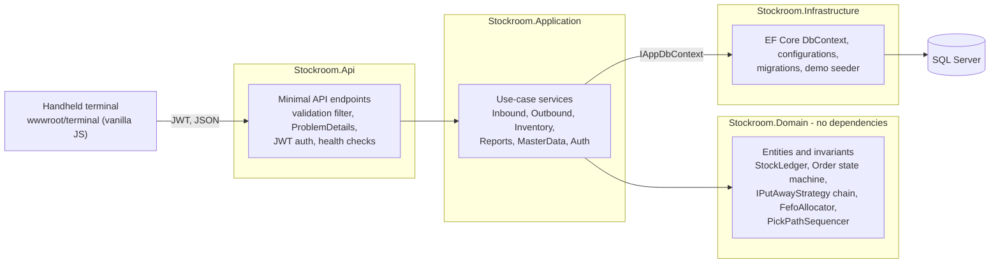

# Stockroom WMS

A small warehouse management system (WMS) core: inbound receiving against ASNs, rule-based put-away,
FEFO allocation, picking on a handheld-scanner web terminal, transfers and stock counts.
Every stock change goes through an append-only movement ledger.

Built with C# / .NET 10, ASP.NET Core minimal APIs, EF Core + SQL Server, and a vanilla-JS terminal UI.

The scope is deliberately narrow (one warehouse, units only, no carriers or billing). The rules that make a WMS
trustworthy are covered in depth: stock never goes negative, documents follow strict lifecycles, and two
people working on the same stock cannot corrupt it.

## Architecture



- **Domain**: plain C# with no package references. Behaviour lives in the entities (`Asn.Receive`,
  `Order.Allocate`, `Order.ConfirmPick`, `PutAwayTask.Complete`). Setters are private, and invalid input or
  state throws a `DomainException`.
- **Application**: one service per area. It loads aggregates, calls domain behaviour and saves once.
  Requests are records with FluentValidation validators, and mapping to DTOs is written by hand.
  The services use EF Core's `DbSet` through `IAppDbContext` instead of a repository per entity, because EF
  already provides the unit of work and repositories.
- **Infrastructure**: EF Core mappings, migrations and the demo data seeder.
- **Api**: endpoints, auth, exception-to-ProblemDetails mapping, OpenAPI (Scalar UI in Development) and the
  terminal's static files.

## Domain glossary

| Term | Meaning here |
| --- | --- |
| **Zone** | An area of the warehouse: Receiving (dock), Storage, Picking, Shipping. Storage zones have an **ABC class** (A = fast movers, close to the dock). |
| **Location / bin** | A storage slot coded `zone-aisle-bay-level`, e.g. `A-01-03-2`. Has volume capacity in litres, X/Y coordinates for walking distance, and a blocked flag. |
| **SKU / product** | A product with barcode, unit volume and ABC class. |
| **Lot** | A batch of one product, optionally with an expiry date. Without a lot number the ASN number is used. |
| **ASN** | Advance shipping notice: what the supplier says is on the truck. Receipts are checked against it; partial receipts are fine, over-receipt is rejected. |
| **Put-away** | Moving received goods from the dock to a storage bin. The system suggests the bin; the operator confirms by scanning it. |
| **Allocation** | Reserving specific stock (lot + bin) for an order. Reserved stock cannot be moved, counted below, or allocated twice. |
| **FEFO / FIFO** | First-expired-first-out: earliest expiry ships first. Lots without expiry go oldest receipt first (FIFO). Expired lots are never allocated. |
| **Pick task** | "Take N of lot L from bin B". Tasks are ordered along the walking route. |
| **Short pick** | The picker finds fewer units than expected. The task closes as `Short`, the rest of the reservation is released, and the order ships short. |
| **Ledger / movement** | Immutable record of every physical stock change: Receipt, PutAway, Pick, Transfer, Adjustment. |

## Key design decisions

1. **Ledger plus projection.** `StockItem` (quantity of a lot in a bin) is a projection; its quantity
   setters are `internal`. Only the domain service `StockLedger` changes it, and each call returns the matching
   `StockMovement`. The movement and the new quantity are saved in the same `SaveChanges`, so in one
   transaction. Movements are append-only: `AppDbContext` refuses to update or delete them. "Never negative"
   is enforced three times: in the domain, by SQL check constraints (`Quantity >= 0`,
   `0 <= ReservedQuantity <= Quantity`), and by an integration test that bypasses the domain to prove the
   database rejects it.
2. **Put-away as a Strategy chain.** `IPutAwayStrategy` has three implementations:
   - `ConsolidateSameLot`: top up a bin already holding the same SKU and lot.
   - `EmptyBinInAbcZone`: nearest empty bin in a zone matching the product's ABC class.
   - `AnyBinWithCapacity`: fallback.

   `PutAwayStrategyChain` returns the first answer. The order is set in configuration
   (`PutAway:Strategies`), and an unknown name fails at startup. Bins count as occupied if they hold stock
   or if an open put-away task is already heading there, so two pallets are not sent to the same empty bin.
3. **Optimistic concurrency.** SQL Server `rowversion` columns are mapped as EF shadow properties (so the
   domain model stays clean) on stock items, orders, pick tasks, put-away tasks and ASN lines. When two
   pickers confirm the same stock, the second `SaveChanges` fails with `DbUpdateConcurrencyException`,
   which the API returns as **409 Conflict**. An integration test fires both requests at once.
4. **Order state machine.** `New → Allocated → Picking → Picked → Shipped` is a whitelist of transitions
   inside `Order`. Anything else throws `InvalidStateTransitionException`, returned as 409. Allocation is
   all-or-nothing: if one line cannot be covered, nothing is reserved.
5. **Walking order.** Pick tasks are numbered along a serpentine route: aisles left to right, alternating
   up and down. A picker never walks the same aisle twice.
6. **Errors are RFC 7807 everywhere.** The status codes are:

   | Status | When |
   | --- | --- |
   | 400 | Validation failure, with per-field errors |
   | 401 / 403 | Authentication or authorization |
   | 404 | Unknown resource |
   | 409 | Duplicate, invalid state transition, or concurrency conflict |
   | 422 | Business rule violated (over-receipt, insufficient stock, wrong bin scanned) |
   | 500 | Unexpected error: logged, details hidden |

## Running locally

Prerequisites: .NET 10 SDK and SQL Server (Express is fine). The default connection string in
`src/Stockroom.Api/appsettings.json` is:

```
Server=localhost\SQLEXPRESS;Database=StockroomWms;Trusted_Connection=True;TrustServerCertificate=True
```

```powershell
dotnet tool restore
dotnet run --project src/Stockroom.Api --launch-profile http
```

In Development the app applies migrations and seeds a demo warehouse on startup:
- a dock, 2 storage zones with 60 bins, and shipping;
- 15 products and opening stock;
- open ASN `ASN-1001`;
- order `SO-2001` (new) and order `SO-2002` (already allocated, so the terminal has pick tasks).

| What | URL |
| --- | --- |
| Handheld terminal | http://localhost:5262/terminal/ |
| API reference (Scalar) | http://localhost:5262/scalar/v1 |
| OpenAPI document | http://localhost:5262/openapi/v1.json |
| Health (includes DB check) | http://localhost:5262/health |

**Demo credentials (demo only, defined in `appsettings.Development.json`):**

| User | Password | Role |
| --- | --- | --- |
| `operator` | `Operator#2026` | Operator: receive, put-away, pick, transfer, ship |
| `manager` | `Manager#2026` | Manager: everything above plus master data, ASNs, orders, allocation, adjustments |

The JWT signing key in `appsettings.Development.json` is also demo only. Outside Development, set
`Jwt__SigningKey` (32 or more bytes) from a secret store; the app refuses to start without one.
Outside Development, run migrations with `dotnet ef migrations bundle` instead of on startup.

To try a full cycle as manager in Scalar:
1. `POST /api/orders` to create an order.
2. `POST /api/orders/{id}/allocate` to reserve stock.
3. Pick it on the terminal.
4. `POST /api/orders/{id}/ship` to ship it.

**Docker:** `docker compose up --build` starts SQL Server 2022 and the API on http://localhost:8080
(Development mode, demo data).

## Tests

```powershell
dotnet test
```

- **Unit tests** (`tests/Stockroom.UnitTests`, no database) cover:
  - put-away strategies and chain ordering;
  - FEFO/FIFO allocation, including expired, blocked and not-yet-put-away stock;
  - every order state transition;
  - all-or-nothing allocation and short picks;
  - receiving rules (partial receipts, over-receipt, closed ASN);
  - ledger invariants (never negative, reserved stock protected);
  - the walking route.
- **Integration tests** (`tests/Stockroom.IntegrationTests`) run the real API through `WebApplicationFactory`
  against real SQL Server. Each run uses its own `StockroomWms_Tests_<guid>` database and drops it afterwards.
  They cover:
  - receive → put-away → pick → ship end to end over HTTP;
  - 409 on concurrent picks and a rowversion conflict;
  - the database check constraint against negative stock;
  - 401/403 role checks;
  - 400 validation ProblemDetails, 404, 409 and 422.

  The server defaults to `localhost\SQLEXPRESS`; override it with the `STOCKROOM_TEST_SQL` environment
  variable (the CI workflow does this for its SQL Server container).

## API overview

All endpoints except login and health need a bearer token. "Op" means Operator or Manager; "Mgr" means Manager only.
List endpoints take `page` and `pageSize` (maximum 100) and return `{ items, page, pageSize, totalCount }`.

| Method | Path | Role | Purpose |
| --- | --- | --- | --- |
| POST | `/api/auth/login` | - | Get a JWT |
| GET | `/health` | - | Liveness plus DB check |
| GET / POST | `/api/products` | Op / Mgr | List (`search`) / create product |
| GET | `/api/locations` | Op | List bins (`zone`) |
| POST | `/api/locations/{code}/block`, `/unblock` | Mgr | Block or unblock a bin |
| GET / POST | `/api/asns` | Op / Mgr | List (`status`) / create ASN |
| GET | `/api/asns/{id}` | Op | ASN with lines |
| POST | `/api/asns/{id}/receipts` | Op | Receive a line to the dock; returns the suggested put-away bin |
| GET | `/api/putaway-tasks` | Op | List (`status`) |
| POST | `/api/putaway-tasks/{id}/confirm` | Op | Scan the bin to complete the put-away |
| GET / POST | `/api/orders` | Op / Mgr | List (`status`) / create order |
| GET | `/api/orders/{id}` | Op | Order with lines and pick tasks |
| POST | `/api/orders/{id}/allocate` | Mgr | FEFO allocation and pick task generation |
| POST | `/api/orders/{id}/ship` | Op | Ship a picked order |
| GET | `/api/pick-tasks/next` | Op | Next task in walking order (`orderId` optional); 204 if none |
| POST | `/api/pick-tasks/{id}/confirm` | Op | Scan location and barcode, enter quantity; a lower quantity is a short pick |
| POST | `/api/transfers` | Op | Move stock between bins |
| POST | `/api/adjustments` | Mgr | Physical count with a reason; books the difference |
| GET | `/api/stock` | Op | Current stock (`sku`, `barcode`, `locationCode`) |
| GET | `/api/reports/movements` | Op | Movement history for a SKU |
| GET | `/api/reports/expiring` | Op | Lots expiring within `days` (default 30) |

## Known shortcuts and what's next

- Quantities are in units only: no packs or pallets, and no unit-of-measure conversion.
- Picking removes goods from stock (a `Pick` movement to "outside"). There is no staging in the
  shipping zone and no pack/ship confirmation by carrier.
- A short pick does not automatically block the bin or create a count task; a manager follows up with an
  adjustment.
- Put-away suggestions load all bins of the warehouse into memory. That is fine for thousands of bins;
  beyond that the filtering should move into SQL.
- Two receipts that create the very first stock row for the same lot and bin at the same instant would hit
  the unique index and return 500 rather than 409.
- The terminal loads only the first 50 items of each list.
- Next steps:
  - waves and batch picking across orders;
  - replenishment from reserve to pick-face bins;
  - cycle-count tasks;
  - an outbox for integration events;
  - a refresh-token flow.
